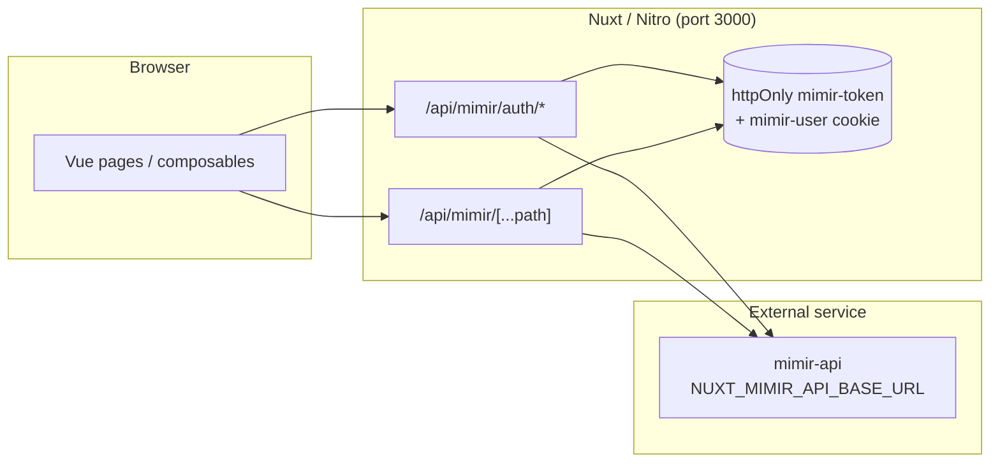
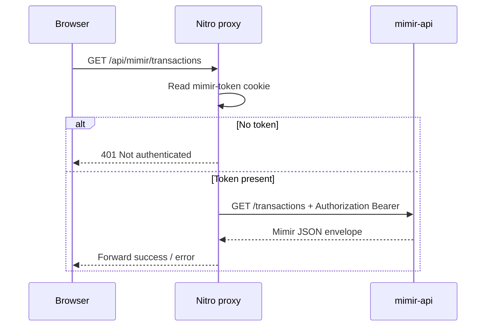

# Mimir Dashboard

Web UI for the Mimir personal finance stack: period summaries, transactions, categories, and bot draft review. Authentication uses JWT stored in an httpOnly cookie on the Nuxt server; the browser never holds the API token.

**Languages:** [🇺🇸 English](#table-of-contents) · [🇧🇷 Português](#português)


| | |
|---|---|
| **Frontend** |     |
| **Server** |   |
| **Tooling** |   |
| **Ops** |  |

---

## Table of contents

- [Overview](#overview)
- [Features and usability](#features-and-usability)
- [Technical stack](#technical-stack)
- [Architecture](#architecture)
- [Current implementation notes](#current-implementation-notes)
- [Project structure](#project-structure)
- [Getting started](#getting-started)
- [Usage](#usage)
- [BFF API surface](#bff-api-surface)
- [Development](#development)
- [Testing and quality checks](#testing-and-quality-checks)
- [Deployment and operations](#deployment-and-operations)
- [Security](#security)
- [Troubleshooting](#troubleshooting)
- [License](#license)

---

## Overview

Mimir Dashboard is the visualization and management layer for the Mimir personal finance API. It targets individuals (or households) who track income and expenses through Mimir and need a browser-based way to review summaries, edit data, and approve drafts created by automation (for example the Mimir bot).

The app is a **Nuxt 4** single-page experience built with **Nuxt UI**. All upstream API calls go through a **Nitro BFF** (`/api/mimir/*`) so JWT credentials stay on the server in httpOnly cookies.

**Out of scope for this repository:** persistence, business rules, and the REST API itself live in **mimir-api** (separate service). This repo expects a running API at `NUXT_MIMIR_API_BASE_URL`.

---

## Features and usability

| Area | Status | Description |
|------|--------|-------------|
| Overview dashboard | Implemented | Date-range totals, expense breakdown by category, monthly table, recent transactions; quick create/edit transactions from overview |
| Transactions | Implemented | List with filters, create, edit, delete |
| Categories | Implemented | List and create categories |
| Drafts | Implemented | Review pending bot drafts; confirm, reject, or edit payload before confirm |
| Account | Implemented | Profile display and logout |
| Auth | Implemented | Register, login, session check; protected routes via global middleware |

### User roles and flows

- **Authenticated user:** After login or register, access all app routes. Unauthenticated visitors are redirected to `/login`.
- **Guest:** Can use `/login` and `/register` only; successful auth redirects to `/`.

### Main routes

| Route | Purpose |
|-------|---------|
| `/` | Overview — period totals, category breakdown, monthly summary, recent transactions |
| `/transactions` | Full transaction list and CRUD |
| `/categories` | Category list and creation |
| `/drafts` | Pending draft queue from external sources (e.g. bot) |
| `/account` | User profile and logout |
| `/login`, `/register` | Authentication |

Light mode is the default (`colorMode` preference `light`); theme preference is stored in `localStorage` under `mimir-color-mode`.

---

## Technical stack

| Layer | Technology | Role |
|-------|------------|------|
| Framework | Nuxt 4, Vue 3 | App shell, routing, SSR-capable UI |
| UI | Nuxt UI 4, Tailwind CSS 4, Lucide icons | Layout, forms, tables, dashboard components |
| Charts / tables | Unovis, TanStack Table Core | Visualizations and data grids where used |
| Validation | Zod | Client-side schema validation |
| Dates | date-fns, `@internationalized/date` | Formatting and range pickers |
| Utilities | VueUse | Composables and browser helpers |
| Server | Nitro (Nuxt server) | Auth cookie handling, proxy to mimir-api |
| Package manager | pnpm 11.1.3 | Installs and scripts (`packageManager` field) |
| Container | Docker, Compose, Node 24 Alpine | Dev hot reload and production Nitro image |
| CI | GitHub Actions (Node 22) | `pnpm install`, lint, typecheck on push |

Google Fonts fetching is disabled in Nuxt UI config (`ui.fonts: false`) to avoid build/dev dependency on `fonts.google.com`.

---

## Architecture

The dashboard follows a **BFF (backend-for-frontend)** pattern: the browser only talks to the Nuxt origin; Nitro forwards authenticated requests to mimir-api.



### Request lifecycle (authenticated API call)



### Major components

| Component | Location | Responsibility |
|-----------|----------|----------------|
| Pages | `app/pages/` | Route-level UI and data loading |
| Mimir components | `app/components/mimir/` | Domain modals, stats, lists |
| `useMimirAuth` | `app/composables/useMimirAuth.ts` | Session, login, register, logout |
| `useMimirApi` | `app/composables/useMimirApi.ts` | Typed client for proxied REST paths |
| `useMimirRefresh` | `app/composables/useMimirRefresh.ts` | Invalidate `useAsyncData` keys after mutations |
| Auth middleware | `app/middleware/auth.global.ts` | Redirect unauthenticated users |
| `mimirProxy` | `server/utils/mimirProxy.ts` | Cookie helpers, `$fetch` to API |
| Catch-all proxy | `server/api/mimir/[...path].ts` | Forwards GET/POST/PATCH/DELETE (excludes `auth/*`) |
| Auth handlers | `server/api/mimir/auth/` | Login, register, logout, session |

Upstream responses use a consistent envelope (`success`, `statusCode`, `data`, `message`) defined in `app/types/index.d.ts` and mirrored in `server/utils/mimirProxy.ts`.

---

## Current implementation notes

This repository does **not** include formal Architecture Decision Records (`docs/adr/`). The following choices are visible in code and configuration:

| Topic | Choice | Trade-off |
|-------|--------|-----------|
| Token storage | httpOnly `mimir-token` cookie (7-day `maxAge`) | JWT not exposed to JavaScript; requires same-site cookie rules |
| User display | Non-httpOnly `mimir-user` JSON cookie + `useState` | Fast session UI without decoding JWT in the browser |
| Auth vs proxy | Dedicated `/api/mimir/auth/*` routes; catch-all blocks `auth/` | Login/register set cookies server-side; generic proxy cannot bypass auth flow |
| API URL | `runtimeConfig.mimirApiBaseUrl` from `NUXT_MIMIR_API_BASE_URL` | Server-only env; not leaked to client bundle |
| Docker → host API | `host.docker.internal` in Compose | Works when mimir-api runs on the host; port via `API_PORT` |
| Production edge | Optional external Docker network `homelab` for Caddy | When network exists, `make prod-up` attaches; otherwise publishes `UI_PORT` on localhost |

---

## Project structure

```text
mimir-dashboard/
├── app/
│   ├── components/mimir/    # Domain UI (modals, summaries, navbar)
│   ├── composables/         # useMimirAuth, useMimirApi, useMimirRefresh
│   ├── layouts/             # default + auth layouts
│   ├── middleware/          # auth.global.ts
│   ├── pages/               # File-based routes
│   ├── types/               # API and domain TypeScript types
│   └── utils/               # Mimir helpers (errors, date ranges)
├── server/
│   ├── api/mimir/           # BFF: auth + [...path] proxy
│   └── utils/mimirProxy.ts
├── public/                  # Static assets (logo, favicon)
├── docker-compose*.yml      # Prod, dev overlay, optional homelab network
├── Dockerfile               # Production Nitro build
├── Dockerfile.dev           # Dev container with pnpm dev
├── Makefile                 # setup, dev, prod-up, host-dev, …
└── .github/workflows/ci.yml
```

Reference OpenAPI (template, not served by default): `server/api/template/mimir-openapi(3).json`.

---

## Getting started

### Prerequisites

- **Docker + Compose** (recommended), or
- **Node.js** 20+ and **pnpm** 11.x for host development (CI runs on Node 22; Docker images use Node 24)
- A running **mimir-api** instance (default `http://localhost:5000`)

### 1. Clone

```bash
git clone git@github.com:tyr-vault/mimir-dashboard.git
cd mimir-dashboard
```

### 2. Environment

```bash
make setup   # copies .env.example → .env if missing
```

| Variable | Required | Purpose |
|----------|----------|---------|
| `NUXT_MIMIR_API_BASE_URL` | Yes | Upstream mimir-api base URL (Nitro proxy target) |
| `NUXT_PUBLIC_SITE_URL` | Yes | Public dashboard URL (OG tags, absolute links) |
| `UI_PORT` | No (Make) | Host port mapped to container `3000` (default `3000`) |
| `API_PORT` | No (Make/Docker) | Host port for mimir-api when using `host.docker.internal` (default `5000`) |
| `HOMELAB_NETWORK` | No | External Docker network name for prod + Caddy (default `homelab`) |

See `.env.example` for defaults.

### 3. Run with Docker (recommended)

Same pattern as sibling Mimir repos: base `docker-compose.yml` (production image) + `docker-compose.dev.yml` (hot reload).

```bash
make dev          # foreground dev stack, http://localhost:3000
make up           # detached dev
make logs         # follow dev logs
make down         # stop dev stack

make prod-up      # build and run production Nitro server
make prod-logs
make prod-down
```

Inside Docker, Nitro reaches the API at `http://host.docker.internal:${API_PORT}` unless overridden in `.env`.

From a Mimir **meta** monorepo (if you use one): `make dev ui` or `make prod ui`.

### 4. Run on the host (optional)

```bash
pnpm install
cp .env.example .env   # if not already created
make host-dev          # pnpm dev on UI_PORT (default 3000)
```

Ensure `NUXT_MIMIR_API_BASE_URL` points at your local mimir-api (typically `http://localhost:5000`).

### 5. Verify

- Open `http://localhost:3000` (or your `UI_PORT`).
- Register or log in; you should land on `/` with summary data when the API is healthy.
- If the API is down, proxied routes return errors (often HTTP 502 with a Nitro error message).

---

## Usage

### Log in and review finances

1. Navigate to `/login` and sign in (or `/register` to create an account).
2. On **Overview** (`/`), adjust the date range to refresh period totals, category breakdown, and recent transactions.
3. Use **Transactions** and **Categories** for full CRUD.
4. Open **Drafts** to confirm or reject pending items created by external integrations.

### Example: list transactions from the browser

The UI uses composables; equivalent browser request after login:

```http
GET /api/mimir/transactions?limit=10 HTTP/1.1
Host: localhost:3000
Cookie: mimir-token=…
```

Nitro translates this to `GET {NUXT_MIMIR_API_BASE_URL}/transactions` with `Authorization: Bearer …`.

---

## BFF API surface

These routes are implemented in this repo. Paths mirror mimir-api resources unless noted.

| Method | Path | Auth | Notes |
|--------|------|------|-------|
| POST | `/api/mimir/auth/login` | No | Sets cookies; returns `{ user }` |
| POST | `/api/mimir/auth/register` | No | Sets cookies; returns `{ user }` |
| POST | `/api/mimir/auth/logout` | No | Clears auth cookies |
| GET | `/api/mimir/auth/session` | No | `{ authenticated, user }` from cookies |
| * | `/api/mimir/{path}` | Yes* | Proxies to `{base}/{path}`; methods GET, POST, PATCH, DELETE |

\*Proxy requires a valid `mimir-token` cookie except where mimir-api allows anonymous access (the proxy defaults to `requireAuth: true`).

Client-side helpers in `useMimirApi()` include: `categories`, `transactions`, `summary`, `summary/categories`, `summary/monthly`, and `drafts` (including confirm/reject).

Full upstream contract: see mimir-api documentation or `server/api/template/mimir-openapi(3).json`.

---

## Development

```bash
pnpm install
pnpm dev              # same as make host-dev without Make wrapper
pnpm run lint         # ESLint (@nuxt/eslint)
pnpm run typecheck    # vue-tsc via nuxt typecheck
pnpm run build        # production Nitro output to .output/
pnpm run preview      # preview production build
```

Editor defaults: `.editorconfig`, `.vscode/settings.json`. ESLint stylistic rules: no trailing comma dangle, 1tbs braces (`nuxt.config.ts`).

There is no `CONTRIBUTING.md` in this repository; use your team’s usual fork / branch / pull request workflow.

---

## Testing and quality checks

| Check | Command | Where |
|-------|---------|--------|
| Lint | `pnpm run lint` | Local and CI |
| Typecheck | `pnpm run typecheck` | Local and CI |

There are **no automated unit or E2E test scripts** in `package.json` at present. Coverage is not configured.

---

## Deployment and operations

| Mode | Command | Notes |
|------|---------|-------|
| Dev container | `make up` / `make dev` | Bind mount + `dashboard_node_modules` volume |
| Prod container | `make prod-up` | Multi-stage `Dockerfile`, runs `node .output/server/index.mjs` |
| Homelab / Caddy | `make prod-up` when Docker network `homelab` exists | Adds `docker-compose.homelab-network.yml`; Caddy can `reverse_proxy mimir-dashboard:3000` |
| Host prod (legacy) | — | `make stop-host-prod` stops a previous `.prod-server.pid` process if present |

Build-time args for production images: `NUXT_MIMIR_API_BASE_URL`, `NUXT_PUBLIC_SITE_URL` (see `Dockerfile`).

Operational logs: `make logs` (dev) or `make prod-logs` (prod).

---

## Security

- **Secrets:** Do not commit `.env`. Only variable names are documented here.
- **JWT:** Stored in httpOnly `mimir-token`; `secure` flag enabled outside development.
- **Session invalidation:** Upstream 401 responses clear auth cookies in the proxy.
- **CORS:** `routeRules` enable CORS for `/api/**` (relevant for cross-origin API access patterns).
- **Vulnerability reporting:** No `SECURITY.md` in this repo; contact maintainers via your organization’s usual channel.

---

## Troubleshooting

| Symptom | Likely cause | What to try |
|---------|----------------|-------------|
| 502 / “Failed to reach Mimir API” | API not running or wrong base URL | Start mimir-api; check `NUXT_MIMIR_API_BASE_URL` and `API_PORT` in Docker |
| 503 “NUXT_MIMIR_API_BASE_URL is not configured” | Missing runtime config | Set env in `.env` or Compose `environment` |
| 401 on all data routes | Missing or expired cookie | Log in again; check clock skew and cookie `maxAge` |
| Empty dashboard with no error | API returned empty data | Verify API health and user has data for the selected range |
| Dev file watch in Docker slow | Polling enabled | `CHOKIDAR_USEPOLLING=true` is set in dev Compose |

---

## License

[MIT](LICENSE) — Copyright (c) 2025 Nuxt UI Templates.

---

# Português

## Índice

- [Visão geral](#visão-geral)
- [Funcionalidades e usabilidade](#funcionalidades-e-usabilidade)
- [Stack tecnológica](#stack-tecnológica)
- [Arquitetura](#arquitetura)
- [Notas da implementação atual](#notas-da-implementação-atual)
- [Estrutura do projeto](#estrutura-do-projeto)
- [Primeiros passos](#primeiros-passos)
- [Utilização](#utilização)
- [Superfície da API BFF](#superfície-da-api-bff)
- [Desenvolvimento](#desenvolvimento)
- [Testes e verificações de qualidade](#testes-e-verificações-de-qualidade)
- [Implantação e operações](#implantação-e-operações)
- [Segurança](#segurança)
- [Solução de problemas](#solução-de-problemas)
- [Licença](#licença)

---

## Visão geral

O **Mimir Dashboard** é a camada de visualização e gestão da API de finanças pessoais Mimir. Destina-se a quem registra receitas e despesas no ecossistema Mimir e precisa de um navegador para consultar resumos, editar dados e aprovar rascunhos gerados por automação (por exemplo o bot Mimir).

A aplicação é uma SPA em **Nuxt 4** com **Nuxt UI**. Todas as chamadas à API passam por um **BFF Nitro** (`/api/mimir/*`), mantendo o JWT no servidor em cookies httpOnly — o token não fica exposto ao JavaScript do browser.

**Fora do escopo deste repositório:** persistência, regras de negócio e a API REST propriamente dita ficam no **mimir-api** (serviço separado). Este projeto assume uma API em execução em `NUXT_MIMIR_API_BASE_URL`.

---

## Funcionalidades e usabilidade

| Área | Status | Descrição |
|------|--------|-----------|
| Painel overview | Implementado | Totais por período, despesas por categoria, tabela mensal, transações recentes; criar/editar transações no overview |
| Transações | Implementado | Listagem com filtros, criar, editar, excluir |
| Categorias | Implementado | Listar e criar categorias |
| Rascunhos (drafts) | Implementado | Revisar drafts pendentes do bot; confirmar, rejeitar ou editar antes de confirmar |
| Conta | Implementado | Perfil e logout |
| Autenticação | Implementado | Registro, login, sessão; rotas protegidas via middleware global |

### Perfis e fluxos

- **Usuário autenticado:** Após login ou registro, acessa todas as rotas da aplicação. Visitantes não autenticados são redirecionados para `/login`.
- **Visitante:** Apenas `/login` e `/register`; após auth bem-sucedida, redirecionamento para `/`.

### Rotas principais

| Rota | Finalidade |
|------|------------|
| `/` | Overview — totais, categorias, resumo mensal, transações recentes |
| `/transactions` | CRUD completo de transações |
| `/categories` | Listagem e criação de categorias |
| `/drafts` | Fila de drafts pendentes (ex.: bot) |
| `/account` | Perfil e logout |
| `/login`, `/register` | Autenticação |

Modo claro por padrão; preferência de tema em `localStorage` (`mimir-color-mode`).

---

## Stack tecnológica

A mesma stack descrita na [seção em inglês](#technical-stack): Nuxt 4, Vue 3, Nuxt UI 4, Tailwind 4, Nitro como BFF, pnpm 11.1.3, Docker (Node 24) e CI no GitHub Actions (Node 22). Fontes do Google desativadas na config UI (`ui.fonts: false`).

---

## Arquitetura

Padrão **BFF**: o browser fala só com a origem Nuxt; o Nitro encaminha pedidos autenticados ao mimir-api.

Os diagramas Mermaid acima ([topologia](#architecture) e [sequência de login/API](#architecture)) aplicam-se igualmente à implantação em português.

Resumo dos módulos:

| Módulo | Caminho | Papel |
|--------|---------|-------|
| Páginas | `app/pages/` | UI e carregamento de dados por rota |
| Componentes Mimir | `app/components/mimir/` | Modais, estatísticas, listas |
| `useMimirAuth` | `app/composables/useMimirAuth.ts` | Sessão, login, registro, logout |
| `useMimirApi` | `app/composables/useMimirApi.ts` | Cliente tipado para REST proxied |
| Middleware | `app/middleware/auth.global.ts` | Proteção de rotas |
| Proxy | `server/utils/mimirProxy.ts`, `server/api/mimir/` | Cookies e encaminhamento |

---

## Notas da implementação atual

Não há ADRs formais em `docs/adr/`. Escolhas observáveis:

| Tópico | Decisão | Trade-off |
|--------|---------|-----------|
| Token | Cookie httpOnly `mimir-token` (7 dias) | JWT fora do JS; depende de cookies same-site |
| Usuário na UI | Cookie `mimir-user` + `useState` | Sessão rápida sem decodificar JWT no client |
| Auth | Rotas dedicadas `/api/mimir/auth/*` | Login/registro definem cookies no servidor |
| URL da API | `NUXT_MIMIR_API_BASE_URL` (server-only) | Não vaza para o bundle do client |
| Docker | `host.docker.internal` | API no host; porta via `API_PORT` |
| Produção | Rede Docker `homelab` opcional | Integração com Caddy quando a rede existe |

---

## Estrutura do projeto

Árvore resumida — mesma layout da [seção em inglês](#project-structure).

OpenAPI de referência: `server/api/template/mimir-openapi(3).json`.

---

## Primeiros passos

### Pré-requisitos

- **Docker + Compose** (recomendado), ou **Node.js** 20+ e **pnpm** 11.x (CI: Node 22; imagens Docker: Node 24)
- **mimir-api** em execução (padrão `http://localhost:5000`)

### Clone e ambiente

```bash
git clone git@github.com:tyr-vault/mimir-dashboard.git
cd mimir-dashboard
make setup
```

Variáveis: mesma tabela da [seção Getting started](#2-environment) (`NUXT_MIMIR_API_BASE_URL`, `NUXT_PUBLIC_SITE_URL`, `UI_PORT`, `API_PORT`, `HOMELAB_NETWORK`).

### Docker (recomendado)

```bash
make dev          # dev em primeiro plano
make up           # dev detached
make prod-up      # imagem de produção Nitro
make down / make prod-down
```

No container, a API no host: `http://host.docker.internal:${API_PORT}`.

Monorepo Mimir (se aplicável): `make dev ui` ou `make prod ui`.

### Desenvolvimento no host

```bash
pnpm install
make host-dev
```

### Verificação

Abra `http://localhost:3000`, faça login e confira o overview. Sem API, espere erros de proxy (ex.: 502).

---

## Utilização

1. Acesse `/login` ou `/register`.
2. No **Overview**, ajuste o intervalo de datas.
3. Use **Transactions**, **Categories** e **Drafts** conforme necessário.

Exemplo HTTP após login: `GET /api/mimir/transactions?limit=10` com cookie `mimir-token`; o Nitro adiciona `Authorization: Bearer …` ao mimir-api.

---

## Superfície da API BFF

| Método | Caminho | Auth | Notas |
|--------|------|------|-------|
| POST | `/api/mimir/auth/login` | Não | Define cookies; retorna `{ user }` |
| POST | `/api/mimir/auth/register` | Não | Idem |
| POST | `/api/mimir/auth/logout` | Não | Limpa cookies |
| GET | `/api/mimir/auth/session` | Não | `{ authenticated, user }` |
| * | `/api/mimir/{path}` | Sim* | Proxy GET/POST/PATCH/DELETE |

\*Proxy exige cookie `mimir-token` por padrão.

Helpers em `useMimirApi()`: categorias, transações, resumos (`summary`, `summary/categories`, `summary/monthly`), drafts (confirmar/rejeitar).

Contrato upstream: mimir-api ou `server/api/template/mimir-openapi(3).json`.

---

## Desenvolvimento

```bash
pnpm install
pnpm dev
pnpm run lint
pnpm run typecheck
pnpm run build
pnpm run preview
```

Não há `CONTRIBUTING.md`; use o fluxo de PR da sua equipe.

---

## Testes e verificações de qualidade

| Verificação | Comando |
|-------------|---------|
| Lint | `pnpm run lint` |
| Typecheck | `pnpm run typecheck` |

Não há scripts de testes unitários ou E2E no `package.json`. Cobertura não configurada.

---

## Implantação e operações

| Modo | Comando |
|------|---------|
| Dev | `make up` / `make dev` |
| Prod | `make prod-up` |
| Homelab / Caddy | Rede Docker `homelab` detectada automaticamente no `make prod-up` |
| Logs | `make logs` / `make prod-logs` |

Build prod: `Dockerfile` com args `NUXT_MIMIR_API_BASE_URL` e `NUXT_PUBLIC_SITE_URL`.

---

## Segurança

- Não commitar `.env`.
- JWT em cookie httpOnly; `secure` fora do dev.
- 401 upstream limpa cookies no proxy.
- Sem `SECURITY.md`; reporte vulnerabilidades pelo canal da organização.

---

## Solução de problemas

| Sintoma | Causa provável | Ação |
|---------|----------------|------|
| 502 / falha ao alcançar API | API parada ou URL errada | Subir mimir-api; conferir `NUXT_MIMIR_API_BASE_URL` / `API_PORT` |
| 503 URL não configurada | Env ausente | Definir variáveis no `.env` ou Compose |
| 401 em rotas de dados | Sessão inválida | Login novamente |
| Dashboard vazio | Sem dados no período | Conferir API e intervalo de datas |
| Watch lento no Docker | Polling | `CHOKIDAR_USEPOLLING=true` no compose dev |

---

## Licença

[MIT](LICENSE) — Copyright (c) 2025 Nuxt UI Templates.
